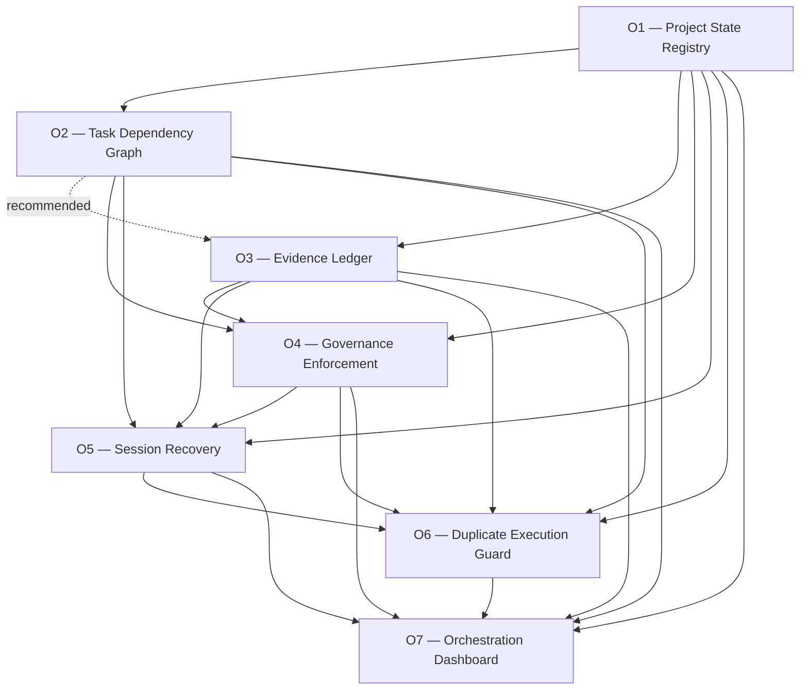

# Task Dependency Graph

> Version: 1
> Scope: coordination dependencies for O1–O7 in the Fruit Blast engineering workflow.
> Source of truth: [Project State Registry](PROJECT_STATE_REGISTRY.md).
> Status at authoring: O2 is APPROVED for this documentation task; the roadmap status changes to IMPLEMENTED only after this file is committed.

## 1. Purpose and boundaries

This document records task prerequisites, expected outputs, and execution gates. It complements the Project State Registry; it does not replace approved project instructions, architecture decisions, contracts, supplements, or session handoffs.

The graph covers orchestration work items O1–O7 only. It does not infer dependencies among Android P2 milestones. P2 documents remain the source for their own implementation details and verification evidence.

No dependency in this document grants authorization to execute a task. Each state-changing action still requires explicit approval for its exact target and scope.

## 2. Dependency graph

Solid arrows represent prerequisites recorded in the Registry. The O3 relationship to O2 is advisory, not a hard prerequisite.

## 3. Work-item contracts

| Work item | Prerequisites | Expected output | Current roadmap state |
|---|---|---|---|
| O1 — Project State Registry | Existing repository baseline | Repository-level project/task snapshot, findings register, verification references, and handoff template | IMPLEMENTED; see Registry commit and CI evidence |
| O2 — Task Dependency Graph | O1 | This document: O1–O7 relationships, prerequisites, outputs, status vocabulary, and execution gates | APPROVED before this commit; IMPLEMENTED when this file is committed |
| O3 — Evidence Ledger | O1 is required; O2 is recommended for consistent task/dependency linkage | Traceable ledger linking task IDs to exact commits, PRs, CI runs, tests, instrumentation artifacts, and device evidence | PROPOSED |
| O4 — Governance Enforcement | O1, O2, and O3 | Auditable authorization, target, scope, constraints, approval, and execution gates | PROPOSED |
| O5 — Session Recovery | O1–O4 | Repeatable session-resume procedure based on repository state, approvals, findings, and evidence | PROPOSED |
| O6 — Duplicate Execution Guard | O1–O5 | Guard against repeating completed work or starting conflicting actions without fresh state checks | PROPOSED |
| O7 — Orchestration Dashboard | O1–O6 | Read-oriented view of task state, dependencies, findings, approvals, and verification evidence | PROPOSED |

### Dependency interpretation

- **Required** means the prerequisite must be present and meet its acceptance condition before the dependent work item can execute.
- **Recommended** means the prerequisite improves consistency but is not a hard blocker. O2 is recommended for O3; O3 may proceed after O1 if its scope explicitly records any missing dependency context.
- **UNCONFIRMED** must be used for any relationship not established by the Registry or an approved architecture/governance source. Do not promote an unconfirmed relationship to required based on assumption.
- The graph records coordination dependencies, not implementation sequencing inside P2 milestones.

## 4. Status vocabulary

Use these states distinctly; they are not interchangeable:

| State | Meaning | Evidence required |
|---|---|---|
| PROPOSED | Work is identified but not authorized | Recorded proposal and scope |
| APPROVED | Exact task, target, and scope have explicit authorization | Approval record |
| IMPLEMENTED | The approved change exists in the target repository or system | Exact commit/ref or artifact |
| TESTED | The relevant test activity was executed | Test command/run and result |
| VERIFIED | Acceptance conditions were checked and passed | Reproducible evidence tied to the exact change |
| BLOCKED | Work cannot proceed because a prerequisite, permission, dependency, or required evidence is missing | Explicit blocker and resolution condition |

Additional reporting labels such as MERGED, DEPLOYED, and ACTIVE must remain separate lifecycle facts. A hosted CI success does not prove physical-device runtime success. A commit does not imply merge, deployment, or activation.

## 5. Execution gates

Before starting a work item:

1. Resolve its required predecessors from the Registry and this graph.
2. Confirm each required predecessor is at the state demanded by the task contract; do not treat PROPOSED or APPROVED as IMPLEMENTED or VERIFIED.
3. Confirm the exact repository, branch/ref, and current baseline SHA.
4. Check for existing implementation, open findings, PRs, and relevant CI/test evidence to prevent duplicate work.
5. Verify explicit authorization for the exact action, target, and file/system scope.
6. Record unresolved or unproven relationships as UNCONFIRMED and stop if they affect safe execution.

A dependent task must not execute while a required predecessor is unmet. A recommended predecessor may be deferred only when the task plan records the reason and preserves traceability.

After execution, record the exact changed files, commit/ref, test evidence, remaining risks, and next permitted action. Mark IMPLEMENTED, TESTED, or VERIFIED only when the corresponding evidence exists.

## 6. P2 documentation references

These documents describe P2 implementation areas. Their presence does not establish additional O1–O7 dependencies, and this graph does not alter their status:

- [P2.17 — Autonomous AI](P2.17-AUTONOMOUS-AI.md)
- [P2.20 — Native Resource Safety](P2.20-NATIVE-RESOURCE-SAFETY.md)
- [P2.28 — Native Process Isolation and Watchdog](P2.28-NATIVE-PROCESS-ISOLATION-WATCHDOG.md)
- P2.30–P2.34 — IPC timeout ownership, process identity, Binder lifecycle races, deterministic fault injection, and watchdog/reconnect race documents (see the corresponding files in this directory)
- [P2.35 — End-to-End Native Runtime Recovery](P2.35-END-TO-END-NATIVE-RUNTIME-RECOVERY.md)
- [P2.38 — Accessibility Window Retrieval Compatibility](P2.38-ACCESSIBILITY-WINDOW-RETRIEVAL-COMPATIBILITY.md)
- [P2.39–P2.43 — Integration Regression](P2.39-P2.43-INTEGRATION-REGRESSION.md)

## 7. Governance

The sole project orchestrator remains `using-agent-skills`. This document does not establish or authorize a competing orchestrator.

This graph is a planning and traceability artifact only. It does not authorize source changes, branch creation, commits, pushes, merges, PR/Issue changes, CI configuration changes, device operations, runtime/VPS/database changes, deployments, releases, plugin installation, or Project Instructions changes.

Any change to Android lifecycle, Accessibility event processing, Activity/window identity, Qwen3-VL integration, native process isolation, Binder lifecycle/reconnect, watchdog recovery, coroutine ownership, single-flight inference, timeout/cancellation, callback invalidation, or resource ownership requires separate impact analysis and explicit approval.

## 8. Maintenance

- Update this graph only within an explicitly approved scope.
- Keep the Registry as the source for current roadmap status and task findings.
- If the Registry and this graph disagree, inspect repository history and approved governance sources; do not silently choose or overwrite one.
- Record new dependencies as UNCONFIRMED until supported by an approved source.
- Do not claim local working-tree cleanliness from remote GitHub inspection.
